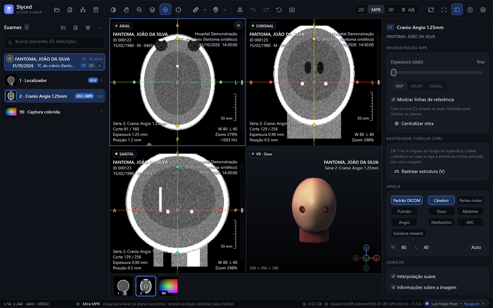
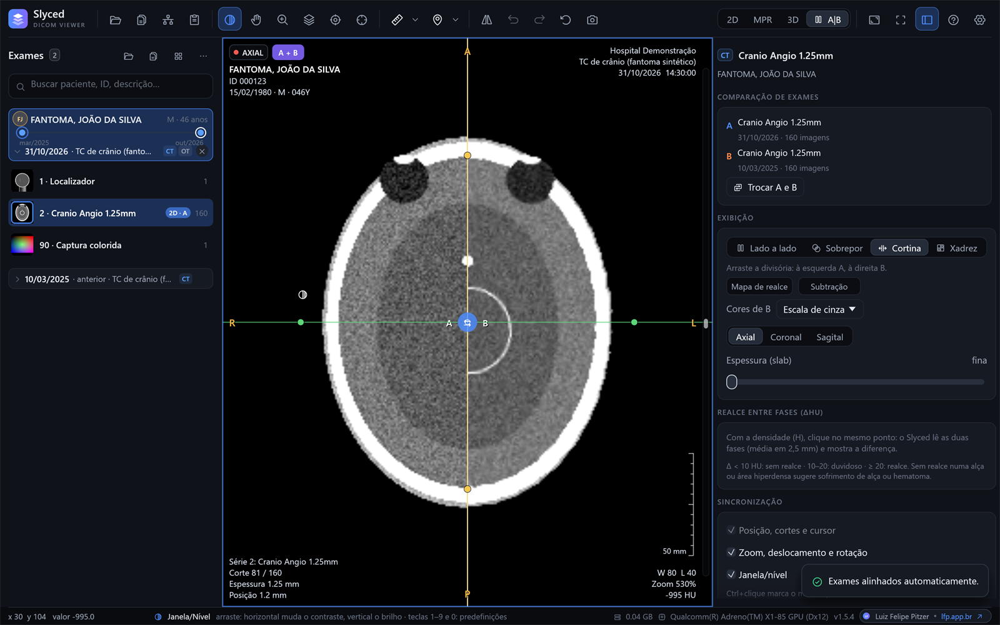
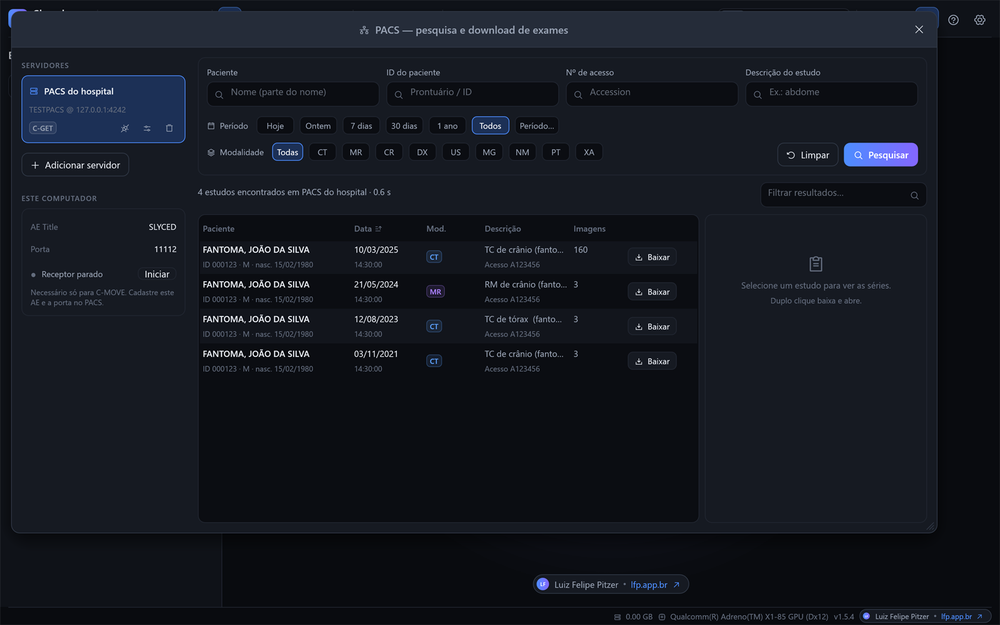
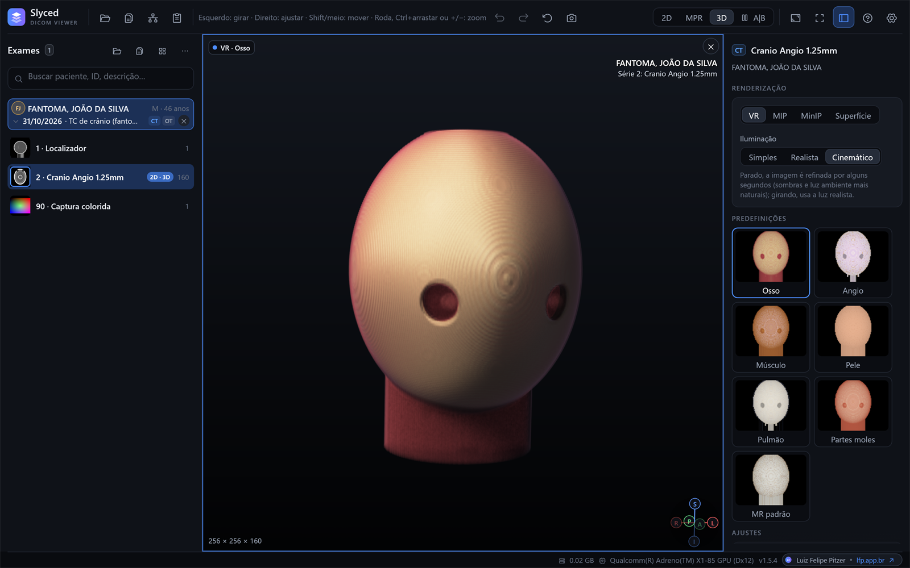
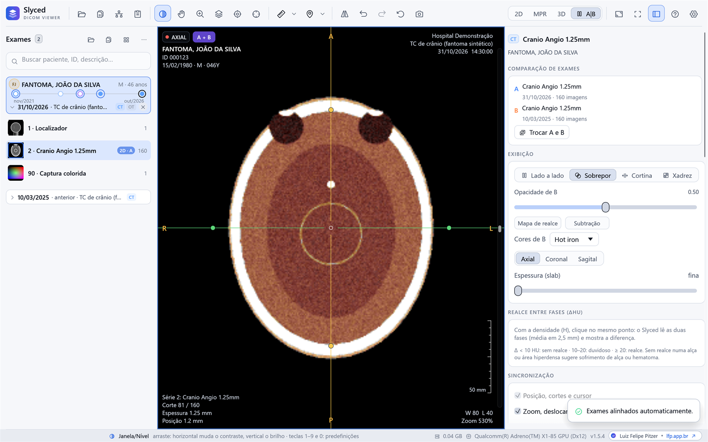
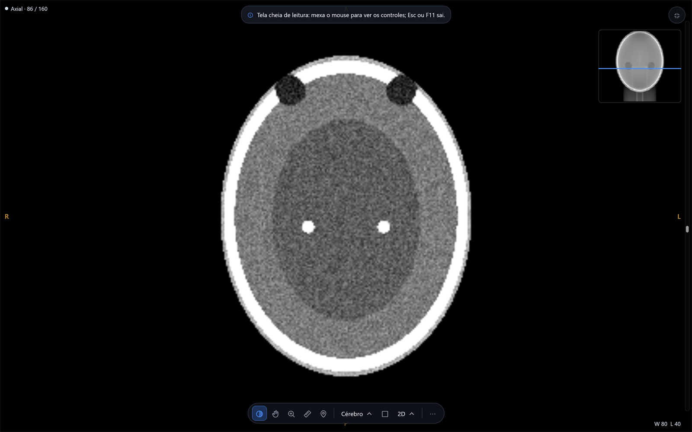
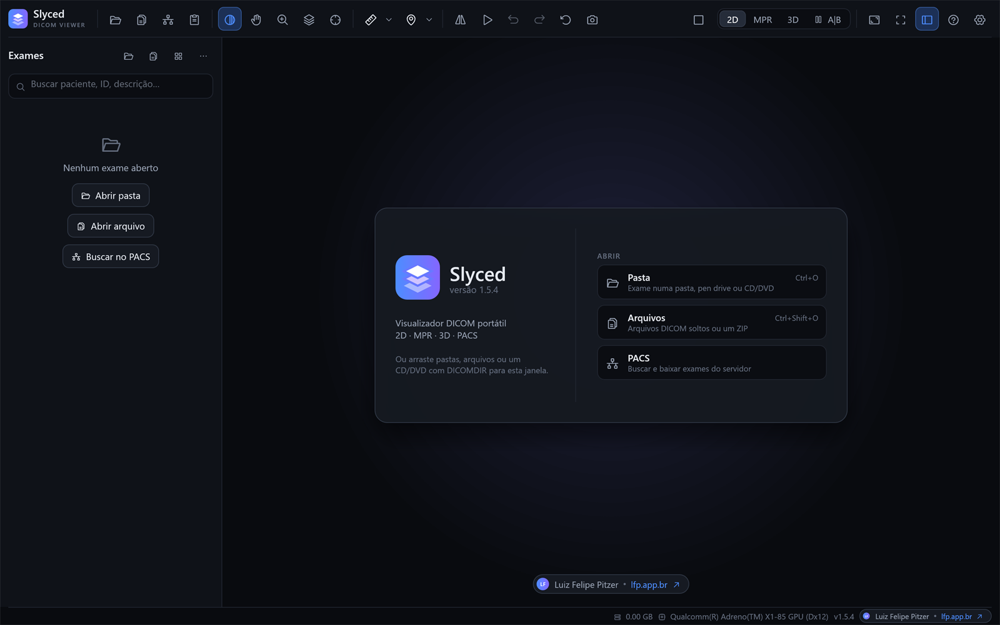

<div align="center">


# Slyced

**Visualizador DICOM portátil para Windows**<br>
TC, RM, RX e US em 2D, MPR e 3D, com comparação de exames e PACS integrado.<br>
Um único `Slyced.exe`, sem instalação, do Windows 7 ao 11.

[](https://github.com/crie-studio/slyced/releases/latest)
[](https://github.com/crie-studio/slyced/releases)
[](#requisitos)
[](#licença)
[](https://www.rust-lang.org)

[**Baixar a versão mais recente**](https://github.com/crie-studio/slyced/releases/latest) ·
[Experimentar no navegador](https://crie-studio.github.io/slyced/?exemplo) ·
[Manual](docs/MANUAL.md) ·
[Novidades](CHANGELOG.md) ·
[Relatar um problema](https://github.com/crie-studio/slyced/issues/new/choose)



</div>

> [!WARNING]
> Software sem certificação como dispositivo médico (ANVISA/FDA/CE). Não utilize como única
> base para diagnóstico.

## Por que o Slyced

- **Portátil de verdade.** Um executável de cerca de 20 MB que roda direto do download ou de
  um pendrive: sem instalador, sem administrador, sem Visual C++ Redistributable.
- **Feito para quem lê exames.** Comparação com o exame anterior, realces de leitura (gás
  livre, gordura mesentérica, cálculos), protocolos de MPR em um clique, rastreador tubular
  (CPR), fases com e sem contraste e calculadora de hérnia incisional.
- **Conectado ao hospital.** Pesquisa e download no PACS por DICOM (C-FIND, C-GET, C-MOVE) ou
  DICOMweb, com fila de downloads e linha do tempo do paciente com todos os exames dele.
- **Leve e rápido.** Escrito em Rust; o 3D roda na placa de vídeo (DirectX 12, Vulkan ou
  OpenGL), e há versões para Windows 7, inclusive de 32 bits.
- **Privado.** Nada sai do computador sem o usuário pedir: sem telemetria, sem contas, sem
  verificação de atualizações.
- **Código aberto**, sob as licenças MIT ou Apache 2.0.

## Telas

<table>
  <tr>
    <td width="50%"></td>
    <td width="50%"></td>
  </tr>
  <tr>
    <td><b>Comparação de exames</b><br>Atual e anterior lado a lado, sobrepostos, em cortina ou em xadrez, alinhados automaticamente.</td>
    <td><b>PACS</b><br>Pesquisa por nome, ID, acesso, período e modalidade; baixa o estudo inteiro ou só as séries marcadas.</td>
  </tr>
  <tr>
    <td></td>
    <td></td>
  </tr>
  <tr>
    <td><b>3D na placa de vídeo</b><br>VR com predefinições (osso, angio, pele, pulmão…), MIP, MinIP e superfície, com iluminação realista ou cinemática.</td>
    <td><b>Temas</b><br>Escuro, claro ou de alto contraste, e tamanho da interface de 80% a 150%.</td>
  </tr>
  <tr>
    <td></td>
    <td></td>
  </tr>
  <tr>
    <td><b>Tela cheia de leitura</b> (F11)<br>Só a imagem; os controles aparecem quando o mouse se mexe.</td>
    <td><b>Abertura</b><br>Pasta, arquivos soltos, ZIP, CD/DVD com DICOMDIR ou PACS.</td>
  </tr>
</table>

<sub>As telas usam um exame sintético gerado pelo próprio projeto (<code>examples/phantom.rs</code>), sem dados de pacientes.</sub>

## Download

Baixe o pacote do seu Windows na [página da versão mais recente](https://github.com/crie-studio/slyced/releases/latest),
descompacte e execute o `Slyced.exe`.

| Pacote | Para |
|---|---|
| `Slyced-<versão>-x64.zip` | **Windows 10 e 11** em PCs Intel ou AMD (quase todos) |
| `Slyced-<versão>-arm64.zip` | Windows 10 e 11 com processador Snapdragon (ARM) |
| `Slyced-<versão>-win7-x64.zip` | Windows 7 SP1, 8 e 8.1 de 64 bits |
| `Slyced-<versão>-win7-x86.zip` | Windows 7 SP1, 8 e 8.1 de 32 bits |

Se o Windows mostrar "O Windows protegeu o computador", clique em **Mais informações → Executar
assim mesmo** (versões sem assinatura digital; veja a [política de assinatura](#política-de-assinatura-de-código-code-signing-policy)).
Para conferir o arquivo, compare `Get-FileHash .\Slyced.exe` com o `SHA256SUMS.txt` do release.

## Versão web (experimental)

O mesmo visualizador roda no navegador, sem instalar nada:
**<https://crie-studio.github.io/slyced/>**. Para ver como funciona sem ter um exame à mão, abra
[com o exame de exemplo](https://crie-studio.github.io/slyced/?exemplo) (sintético, sem dados de pacientes).

Clique no ícone de pasta ou arraste uma pasta, arquivos DICOM ou um ZIP para a página. **Os
exames são abertos no próprio navegador e não são enviados a nenhum servidor.** 2D, MPR e 3D
funcionam como no programa para Windows. Testada até agora em navegadores baseados no Chromium
(como Chrome e Edge) com WebGPU; sem WebGPU, a página usa WebGL2. Por enquanto, diferenças em
relação à versão para Windows:

- sem PACS (o navegador não faz conexões DICOM diretas);
- sem JPEG-LS; JPEG 2000 ainda em teste;
- a série é carregada em um único núcleo, então exames grandes demoram mais e a página fica
  parada enquanto carrega;
- as configurações não são guardadas entre uma visita e outra.

## Recursos

| Área | O que faz |
|---|---|
| **Abrir** | Pastas, arquivos, CDs/DVDs com DICOMDIR e ZIP sem descompactar; JPEG (inclusive 12 bits, sem perdas e aritmético), JPEG-LS, JPEG 2000, RLE, multiframe e cor |
| **2D** | Janela/nível com predefinições, zoom, rotação, mapas de cor, cine, layouts até 3×2, séries sincronizadas por posição e cursor 3D |
| **Navegação** | Prévia do corte na barra, Ctrl+G, localizador, voltar/avançar (Alt+←/→), tira de séries e tela cheia de leitura (F11) |
| **Medidas** | Distância, ângulo, ROI elíptica, densidade (HU) com o tecido provável, setas, achados com nome e volume por 3 diâmetros |
| **MPR e CPR** | Axial, coronal e sagital, slab com MIP/MinIP/média, planos oblíquos e rastreador tubular (apêndice, ureter, colédoco, vasos) |
| **3D** | Ray casting na GPU com VR, MIP, MinIP e superfície; recorte; iluminação simples, realista ou cinemática |
| **Comparação** | Lado a lado, sobreposição, cortina e xadrez; alinhamento por referencial, pontos ou automático; variação das medidas em % |
| **Leitura de TC** | Gás livre, gordura mesentérica, cálculos, fases com e sem contraste (ΔHU, mapa de realce, subtração) e hérnia incisional |
| **PACS** | C-ECHO, C-FIND, C-GET, C-MOVE com receptor embutido e DICOMweb (QIDO-RS/WADO-RS); fila de downloads e limpeza automática |
| **Conforto** | Desfazer/refazer, etiquetas do que mudou na imagem, temas, tour de boas-vindas e atalhos (F1) |

A lista completa, os atalhos e a configuração do PACS estão no [manual](docs/MANUAL.md).

## Requisitos

| Item | Mínimo |
|---|---|
| **Sistema** | Windows 7 SP1, 8, 8.1, 10 ou 11 (32 ou 64 bits, Intel/AMD ou ARM64) |
| **Vídeo** | Placa com DirectX 12, Vulkan ou OpenGL 3.3 para o 3D; sem ela, o Slyced usa a renderização por software do Windows ou abre no modo de compatibilidade (2D e MPR) |
| **Memória** | Usa no máximo metade da memória do computador (ajustável); séries antigas saem da memória e voltam do disco |
| **Instalação** | Nenhuma: dados em `%LOCALAPPDATA%\Slyced` ou, no modo portátil, ao lado do executável |

Problemas para abrir? Veja [requisitos e solução de problemas](docs/MANUAL.md#requisitos-e-solução-de-problemas).

## Política de assinatura de código (Code signing policy)

Free code signing provided by [SignPath.io](https://about.signpath.io/), certificate by
[SignPath Foundation](https://signpath.org/).

Os executáveis dos releases são compilados a partir deste repositório pelo GitHub Actions
([`release.yml`](.github/workflows/release.yml)), em servidores do GitHub, e só são assinados
depois que um aprovador confere e aprova cada pedido de assinatura no SignPath. Pacotes
compilados em outros lugares não recebem essa assinatura. Enquanto a assinatura não estiver
ativa, os pacotes saem sem assinatura digital, com o SHA-256 publicado no release.

*Release executables are built from this repository by GitHub Actions on GitHub-hosted
runners and are signed only after an approver reviews each signing request on SignPath.*

| Papel (role) | Pessoa |
|---|---|
| Autor e revisor (committers and reviewers) | [Luiz Felipe Pitzer](https://lfp.app.br) |
| Aprovador (approvers) | [Luiz Felipe Pitzer](https://lfp.app.br) |

### Privacidade (Privacy policy)

Este programa não transfere nenhuma informação para outros sistemas em rede, a não ser
quando solicitado pelo usuário ou por quem o instala ou opera. Na prática: o Slyced só se
conecta aos servidores PACS (DICOM ou DICOMweb) que o próprio usuário cadastra, e só
quando ele busca ou baixa exames; a porta do receptor DICOM só é aberta se o
usuário ligar o receptor; o site do autor só é aberto no navegador quando o usuário clica
no link. Não há telemetria, estatísticas de uso nem verificação automática de atualizações.

A versão web é uma página estática hospedada no GitHub Pages: os exames abertos nela são lidos
pelo navegador, no próprio computador, e nunca são enviados. Como em qualquer site, o GitHub
recebe os dados técnicos de acesso à página (veja a
[declaração de privacidade do GitHub](https://docs.github.com/pt/site-policy/privacy-policies/github-general-privacy-statement)).

*This program will not transfer any information to other networked systems unless
specifically requested by the user or the person installing or operating it.*

## Compilação

Requisitos: Rust (rustup, com o toolchain nightly e o componente rust-src para as versões de
Windows 7) e Visual Studio 2022 Build Tools com C++ (x64/x86/ARM64), Windows SDK e
"C++ CMake tools for Windows" (usado para compilar o CharLS, de JPEG-LS). Se o `cmake` não estiver
no PATH, defina `CMAKE` com o caminho do `cmake.exe` (o `build-release.ps1` o encontra sozinho).

```powershell
cargo run --release                                  # executar
cargo test                                           # testes
powershell -ExecutionPolicy Bypass -File scripts\build-release.ps1   # dist\ x64, ARM64, win7-x64, win7-x86
```

Pacotes compilados assim não são assinados (o `build-release.ps1` assina com um certificado
próprio se `SLYCED_SIGN_CERT`/`SLYCED_SIGN_PASS` ou `SLYCED_SIGN_THUMBPRINT` estiverem
definidos). Os releases assinados pela SignPath Foundation saem do GitHub Actions ao
publicar uma tag `vX.Y.Z`: veja [docs/ASSINATURA.md](docs/ASSINATURA.md).

A versão web é compilada por `scripts\build-web.ps1` (alvo `wasm32-unknown-unknown` e
`wasm-bindgen-cli` na versão do `Cargo.lock`; instruções no início do script) e publicada no
GitHub Pages pelo workflow `.github/workflows/web.yml` a cada push na `main`.

<details>
<summary><b>Ferramentas de desenvolvimento e arquitetura</b></summary>

```powershell
cargo run --release --example phantom -- C:\temp\fantoma          # TC sintética de crânio
cargo run --release --example phantom -- C:\temp\anterior --anterior   # "exame anterior" (comparação)
cargo run --release --example phantom -- C:\temp\sem --sem-contraste   # fase sem contraste do mesmo exame
cargo run --release --example test_pacs -- C:\temp\fantoma        # mini-PACS local (AE TESTPACS, porta 4242)
cargo run --release --example pacs_selftest -- 127.0.0.1 4242 TESTPACS C:\temp\saida
cargo run --release --example dicomweb_selftest -- http://127.0.0.1:8042/dicom-web C:\temp\saida
cargo run --release --example logo -- docs\img\logo.png 256       # logo em PNG
```

```
src/
  dicom/      varredura de cabeçalhos, decodificação de pixels, montagem de séries e volumes
  imaging/    volume i16 + quantização, MPR (reslice com slab), CPR, filtro de ruído,
              alinhamento entre exames (pontos e informação mútua), LUTs de janela/cores
  render3d/   ray casting wgpu (WGSL), câmera orbital, funções de transferência
  pacs/       DIMSE sobre dicom-ul: SCU (ECHO/FIND/GET/MOVE) e Storage SCP; DICOMweb (QIDO-RS/WADO-RS)
  ui/         tema, viewport 2D/MPR/3D, comparação, achados/protocolos/CPR, painéis, PACS, diálogos
  bookmarks.rs, protocols.rs   achados salvos e protocolos de leitura
  app.rs      estado, workspaces 2D/MPR/3D, atalhos
  jobs.rs     tarefas em segundo plano (varredura, carga, miniaturas, PACS)
  native.rs   início no Windows (log, diagnóstico, escolha da GPU)
  web.rs      início no navegador e ponte com web/index.html (arquivos em memória: dicom/memfs.rs)
```

Bibliotecas principais: [dicom-rs](https://github.com/Enet4/dicom-rs), [egui/eframe](https://github.com/emilk/egui),
[wgpu](https://github.com/gfx-rs/wgpu), rayon, glam. Ícones: [Phosphor](https://phosphoricons.com) (MIT).
Inspiração de interface e fluxos: RadiAnt, Horos, Weasis, OHIF e 3D Slicer (predefinições de VR).

</details>

## Contribuindo

Sugestões e relatos de problemas são bem-vindos nos [issues](https://github.com/crie-studio/slyced/issues/new/choose);
leia o [guia de contribuição](CONTRIBUTING.md) antes de enviar código. **Nunca publique exames,
capturas de tela ou logs com dados de pacientes.** Falhas de segurança devem ser relatadas em
particular, como explica a [política de segurança](SECURITY.md).

## Licença

O Slyced é distribuído sob a licença **MIT** ou a **Apache 2.0**, à escolha de quem o usa
([`LICENSE-MIT`](LICENSE-MIT) e [`LICENSE-APACHE`](LICENSE-APACHE)). Os ícones Phosphor têm
licença própria (MIT, [`assets/fonts/LICENSE-Phosphor.txt`](assets/fonts/LICENSE-Phosphor.txt)),
e as bibliotecas usadas mantêm as licenças delas.

Desenvolvido por **Luiz Felipe Pitzer** · <https://lfp.app.br>

---

### English

**Slyced** is a portable DICOM viewer for Windows 7 to 11 (x64, ARM64 and 32-bit): a single
executable with no installer that opens CT, MR, X-ray and ultrasound studies from folders,
CDs/DVDs (DICOMDIR), ZIP files and PACS servers (DIMSE C-FIND/C-GET/C-MOVE and DICOMweb). It
offers 2D reading tools, MPR with oblique planes and curved reformation, GPU volume rendering
(DirectX 12, Vulkan or OpenGL), side-by-side comparison with prior exams and CT reading aids.
The interface is in Brazilian Portuguese. Written in Rust and licensed under MIT or Apache 2.0.
Downloads are on the [releases page](https://github.com/crie-studio/slyced/releases/latest).
An experimental web version runs in the browser at <https://crie-studio.github.io/slyced/>
([with a synthetic sample exam](https://crie-studio.github.io/slyced/?exemplo)); files opened
there stay on the user's computer.
